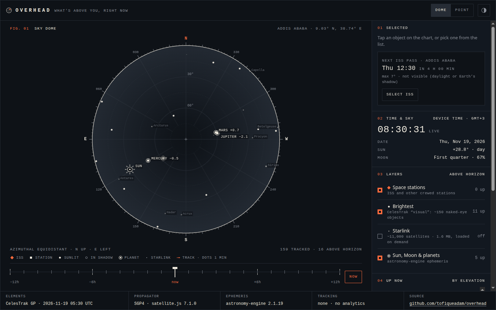
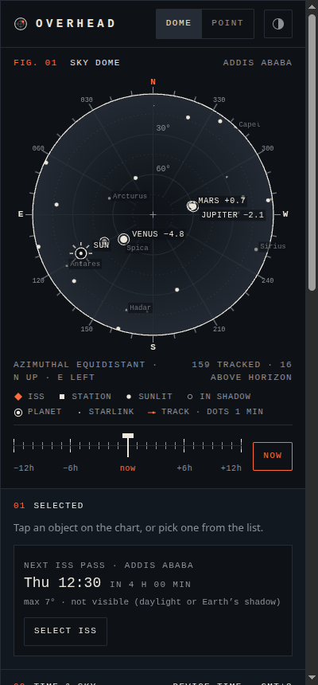

# Overhead

**What's above you, right now.** Satellites, planets, the Sun and the Moon over your location, computed live in the browser.

[](https://github.com/tofiqueadam/overhead/actions/workflows/ci.yml)




Open the page and you see the sky as a chart, drawn like an engineering drawing. Everything in it is computed on your device from orbital elements and planetary ephemerides. It has no backend, no accounts and no analytics.

## Features

- **Live sky dome:** an azimuthal-equidistant chart of everything above your horizon, updated every frame.
- **Point mode:** hold up your phone, and the chart turns to match where the camera is pointing.
- **Satellites:** crewed space stations, about 150 of the brightest objects, and about 11,000 Starlink satellites (loaded on demand).
- **Pass prediction:** each satellite gets its next passes, with rise, peak and set. The app also says whether a pass is *visible to the eye*, meaning the satellite is sunlit while your sky is dark.
- **Next ISS pass** card for your location.
- **Sun, Moon and planets,** with magnitudes, rise and set times, and moon phase.
- **Time scrubber:** move ±12 hours to see what the sky will look like tonight.
- **Your location** from geolocation, a city list, or coordinates you type in. Nothing leaves the browser.

## How it works

| Stage | Detail |
|---|---|
| Orbital elements | CelesTrak GP data, fetched with polite caching. If CelesTrak can't be reached, the app falls back to a bundled snapshot in `data/snapshot/`. |
| Propagation | SGP4 via [satellite.js](https://github.com/shashwatak/satellite-js). Thousands of satellites are propagated in bulk inside a module Web Worker, so the UI stays smooth. |
| Frames | TEME → ECEF → topocentric azimuth and elevation, using WGS-84 geodesy. |
| Passes | Coarse search for horizon crossings, then bisection to find rise and set, then a search for the peak elevation. |
| Bodies | [astronomy-engine](https://github.com/cosinekitty/astronomy) for the Sun, Moon, planets and the reference stars. |
| Rendering | Canvas 2D, with azimuthal-equidistant (dome) and pinhole-camera (point) projections. |

Both libraries are vendored at fixed versions in `vendor/`, so the site runs with no install and no build step.

### Verified, not just plausible

The 47 tests check the maths against independent sources. For example, the ISS position computed from a given set of orbital elements is compared with [wheretheiss.at](https://wheretheiss.at) output for the same elements. Other tests cover the geodesy round trips, the projections, pass timing and formatting.

<p align="center"></p>

## Run it

```bash
npm start      # serves on http://localhost:8080
npm test       # node --test, no dependencies
```

Any static host works, such as GitHub Pages or Cloudflare Pages.

To refresh the bundled orbital elements (please do this rarely, because CelesTrak rate-limits clients):

```bash
npm run snapshot
```

## Credits

Orbital elements come from [CelesTrak](https://celestrak.org). The project uses satellite.js (MIT) and astronomy-engine (MIT); their licences are in `vendor/`.

Code is under the MIT licence.
